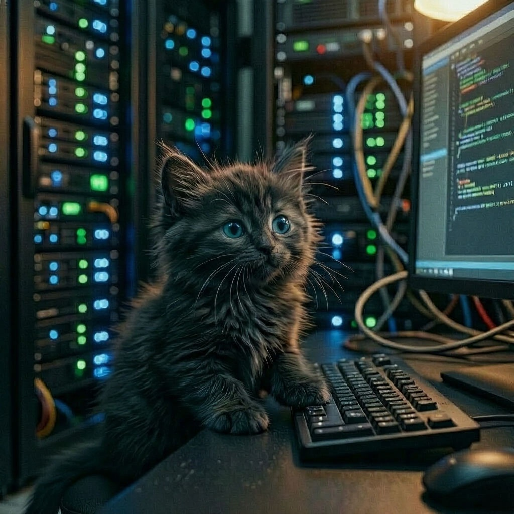

## Отдельная ветка для сервера

Все команды выполняются в терминале из **корневой папки проекта**.

Создать виртуальное окружение:

```powershell
python -m venv .venv
.venv\Scripts\Activate.ps1
```

Для установки зависимостей выполните:

```bash
pip install -r requirements.txt
```

Для очистки локального Git от лишнего кеша:
```bash
git rm -r --cached .idea
```
или
```bash
git rm -r --cached -f .idea
```

Собрать spec файл с помощью pyinstaller можно командой:
```bash
pyi-makespec --onedir --contents-directory "." --name Server  --windowed --icon="resources/images/icons/icon_pdf_maker.ico" --paths="src" --add-data="resources;resources" --add-data="src;src" --hidden-import="PyQt6" --hidden-import="rich" src/main.py
```

Собрать exe файл с помощью pyinstaller:
```bash
pyinstaller Server.spec
```


